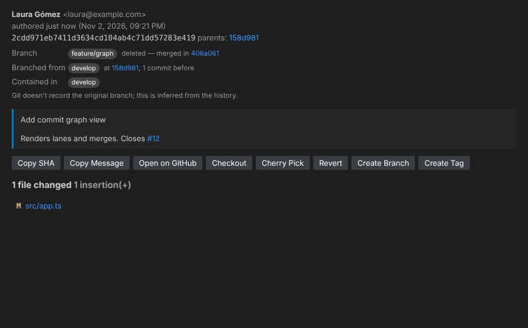

# GitSight — 100% free Git superpowers for VS Code

GitSight is a **free and open-source (MIT)** extension inspired by tools such as GitLens: it shows who changed each line, when and why, and gives you full views of history, branches, stashes, worktrees and an interactive commit graph.

- ✅ No accounts, no subscriptions, no locked "Pro" features
- ✅ No telemetry and no connections to third-party servers: it only uses the `git` installed on your machine
- ✅ Works with public **and private** repositories




## Features

### In the editor
| Feature | Description |
|---|---|
| **Current line blame** | Author, date and message at the end of the line under the cursor (multi-cursor too). |
| **Status bar blame** | Author and date of the current line; click to see the commit. |
| **Rich hovers** | Author, email, date, full message (with links to `#123` issues), refs and shortcuts to: commit details, changes, line history, copy SHA and open on GitHub/GitLab/… |
| **CodeLens** | "Most recent change" and "N authors" above the file and each class/function/method. |
| **Full file blame** (`Alt+B`) | Side annotation with the date and author of each block. |
| **Heatmap** (`Alt+H`) | Color bar by code age (configurable colors). |
| **File changes** | Highlights added, modified and deleted lines against the previous commit or HEAD. |
| **Works with unsaved changes** | Blame is recomputed on the buffer contents. |

### Side views (GitSight icon in the Activity Bar)
- **Commits** — history of the current branch, with incoming/outgoing commits against the upstream.
- **File History** — history of the active file (follows renames) + uncommitted changes.
- **Line History** — history of the selected lines (`git log -L`).
- **Branches** — local branches with ahead/behind, upstream and commits.
- **Remotes** — remotes and their branches.
- **Tags**, **Stashes** (with files), **Worktrees**, **Contributors** (with % of commits).
- **Search & Compare** — search commits by message, author, SHA, file (globs) or code changes (`-G`), and compare branches/tags/commits (commits on each side + changed files).

Each commit expands to show its files; a click opens the diff.

### Commit graph (`Ctrl+Alt+G`)
Interactive graph with colored lanes, merges, branch/tag/HEAD badges, text filter, all branches or only the current one, pagination and quick actions (checkout, create branch, cherry-pick, copy SHA). Click a commit → details panel.

### Commit details panel
Author, committer, dates, navigable parents, **the branch the commit was made on and the branch it branched from** (for example `feature/login` → branched from `develop`, even if the branch was deleted after the merge), branches that contain it, message with issue links, stats and file list (click = diff), and buttons to copy SHA/message, open on the remote, checkout, cherry-pick, revert, create a branch or a tag.

### Comparisons and navigation
- Open changes against the previous revision (`Alt+,`), the working file, any revision or any branch/tag.
- Open the changes of the current line against its previous revision.
- Open a file at a specific revision.
- Navigate back through history from a revision file.

### Supported remotes
GitHub (incl. Enterprise), GitLab (incl. self-hosted), Bitbucket, Azure DevOps and Gitea/Forgejo/Codeberg.
Open a file/selection, commit or repository in the browser and copy the remote URL. For self-hosted servers:

```json
"gitsight.remotes.custom": [{ "domain": "git.mycompany.com", "type": "gitlab" }]
```

### Git actions
Checkout/switch (including remote branches with tracking), create/delete branches, merge, rebase, create/delete tags (lightweight or annotated), cherry-pick, revert, reset (soft/mixed/hard), stash (save, apply, pop, drop), fetch and create/open/remove worktrees. Destructive actions always ask for confirmation.

## Keyboard shortcuts

| Shortcut | Action |
|---|---|
| `Alt+B` | Toggle file blame |
| `Alt+H` | Toggle heatmap |
| `Alt+C` | Show the commit of the current line |
| `Alt+,` | Open changes against the previous revision |
| `Ctrl+Alt+G` / `Cmd+Alt+G` | Open the commit graph |

Everything is also in the Command Palette (`GitSight: …`) and in the editor context menu → **GitSight**.

## Settings

| Setting | Default | Description |
|---|---|---|
| `gitsight.currentLine.enabled` | `true` | Blame at the end of the current line |
| `gitsight.currentLine.format` | `${author}, ${agoOrDate} • ${message}` | Tokens: `${author}`, `${email}`, `${date}`, `${ago}`, `${agoOrDate}`, `${message}`, `${sha}`, `${shortSha}` |
| `gitsight.statusBar.enabled` | `true` | Blame in the status bar |
| `gitsight.statusBar.format` | `$(git-commit) ${author}, ${ago}` | Same format, supports codicons |
| `gitsight.hovers.enabled` | `true` | Hovers with commit details |
| `gitsight.hovers.currentLineOnly` | `true` | Hover only over the current line annotation |
| `gitsight.codeLens.enabled` | `true` | Authorship CodeLens |
| `gitsight.codeLens.scope` | `symbols` | `document` or `symbols` |
| `gitsight.dateStyle` | `relative` | `relative` or `absolute` |
| `gitsight.dateFormat` | `""` | Absolute format (`YYYY-MM-DD HH:mm`); empty = system locale |
| `gitsight.heatmap.hotColor` / `coldColor` | `#f66a0a` / `#0a60f6` | Heatmap colors |
| `gitsight.heatmap.ageThresholdDays` | `90` | Days for a change to count as "hot" |
| `gitsight.views.maxCommits` | `200` | Commits loaded per page |
| `gitsight.baseBranches` | `["main","master","trunk","develop","development","dev"]` | Main branches, by priority, used to infer which branch each commit branched from |
| `gitsight.remotes.custom` | `[]` | Providers for self-hosted domains |

## Installation

### From the Visual Studio Marketplace
Search for **GitSight** in the Extensions view, or install the extension `jamartif.gitsight-free`.

### From GitHub Releases
1. Download the `.vsix` of the latest version from [Releases](https://github.com/jamartif/GitSight/releases).
2. `code --install-extension gitsight-free-X.Y.Z.vsix` (or in VS Code: **Extensions → `…` → Install from VSIX…**).

### From source
```bash
git clone https://github.com/jamartif/GitSight.git
cd GitSight
npm install
npm run package          # creates gitsight-free-<version>.vsix
code --install-extension gitsight-free-<version>.vsix
```

### Development
Open the folder in VS Code and press `F5` ("Run GitSight") to launch a development window with the extension loaded.

```bash
npm run watch   # incremental build
npm test        # tests (parsers, graph layout, remote URLs and a real temporary git repo)
```

### Publishing a new version
Create and push a tag with the version; the `Release` GitHub Action runs the tests, builds the `.vsix` and creates the release with the installer attached:

```bash
git tag v0.2.0
git push origin v0.2.0
```

The `package.json` version is taken from the tag automatically. Tags with a suffix (`v0.2.0-beta.1`) are published as pre-releases. It can also be run by hand from the **Actions** tab (it creates a draft release; publishing the draft creates the tag).

Requirements: VS Code ≥ 1.90 and `git` on the `PATH`.

## Architecture

```
src/
  extension.ts            activation and view registration
  commands.ts             all commands
  context.ts              active repository, blame cache, formatting
  uris.ts                 gitsight: scheme to view files at any revision
  git/
    gitService.ts         typed wrapper over the git CLI
    parsers.ts            pure parsers (blame, log, refs, stashes, worktrees…)
    graphLayout.ts        graph lane algorithm
    remoteProviders.ts    GitHub/GitLab/Bitbucket/Azure/Gitea URLs
  annotations/            line blame, hovers, CodeLens, file blame/heatmap/changes
  views/                  tree views
  webviews/               commit graph and commit details
```

## License

[MIT](LICENSE) © jamartif — use it, modify it and share it freely. GitSight has no runtime dependencies besides VS Code and your `git`.

Issues and suggestions: [github.com/jamartif/GitSight/issues](https://github.com/jamartif/GitSight/issues).

> GitSight is an independent project and is not affiliated with GitLens or GitKraken.
