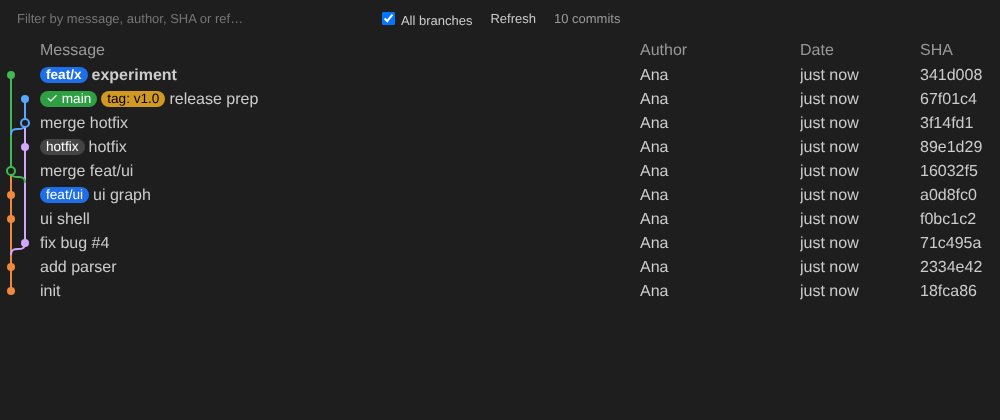

# GitSight — Git superpoderes 100 % gratis para VS Code

GitSight es una extensión **gratuita y de código abierto (MIT)** inspirada en el tipo de herramientas como GitLens: te muestra quién cambió cada línea, cuándo y por qué, y te da vistas completas del historial, ramas, stashes, worktrees y un grafo de commits interactivo.

- ✅ Sin cuentas, sin suscripciones, sin funciones "Pro" bloqueadas
- ✅ Sin telemetría ni conexiones a servidores propios: solo usa el `git` instalado en tu equipo
- ✅ Funciona con repositorios públicos **y privados**



## Funcionalidades

### En el editor
| Función | Descripción |
|---|---|
| **Blame de la línea actual** | Autor, fecha y mensaje al final de la línea donde está el cursor (también con multicursor). |
| **Blame en la barra de estado** | Autor y fecha de la línea actual; clic para ver el commit. |
| **Hovers enriquecidos** | Autor, email, fecha, mensaje completo (con enlaces a issues `#123`), refs y accesos a: detalles del commit, cambios, historial de la línea, copiar SHA y abrir en GitHub/GitLab/… |
| **CodeLens** | "Cambio más reciente" y "N autores" encima del archivo y de cada clase/función/método. |
| **Blame de archivo completo** (`Alt+B`) | Anotación lateral con fecha y autor de cada bloque. |
| **Heatmap** (`Alt+H`) | Barra de color por antigüedad del código (colores configurables). |
| **Cambios del archivo** | Resalta líneas añadidas, modificadas y borradas respecto al commit anterior o a HEAD. |
| **Funciona con cambios sin guardar** | El blame se recalcula sobre el contenido del buffer. |

### Vistas laterales (icono GitSight en la barra de actividades)
- **Commits** — historial de la rama actual, con commits entrantes/salientes respecto al upstream.
- **File History** — historial del archivo activo (sigue renombrados) + cambios sin confirmar.
- **Line History** — historial de las líneas seleccionadas (`git log -L`).
- **Branches** — ramas locales con ahead/behind, upstream y commits.
- **Remotes** — remotos y sus ramas.
- **Tags**, **Stashes** (con archivos), **Worktrees**, **Contributors** (con % de commits).
- **Search & Compare** — busca commits por mensaje, autor, SHA, archivo (globs) o cambios en el código (`-G`), y compara ramas/tags/commits (commits de cada lado + archivos cambiados).

Cada commit se expande para ver sus archivos; un clic abre el diff.

### Grafo de commits (`Ctrl+Alt+G`)
Grafo interactivo con carriles de colores, merges, badges de ramas/tags/HEAD, filtro por texto, todas las ramas o solo la actual, paginación y acciones rápidas (checkout, crear rama, cherry-pick, copiar SHA). Clic en un commit → panel de detalles.

### Panel de detalles del commit
Autor, committer, fechas, padres navegables, mensaje con enlaces a issues, estadísticas y lista de archivos (clic = diff), y botones para copiar SHA/mensaje, abrir en remoto, checkout, cherry-pick, revert, crear rama o tag.

### Comparaciones y navegación
- Abrir cambios con la revisión anterior (`Alt+,`), con el archivo de trabajo, con cualquier revisión o con cualquier rama/tag.
- Abrir los cambios de la línea actual con su revisión anterior.
- Abrir un archivo en una revisión concreta.
- Navegar hacia atrás en el historial desde un archivo de revisión.

### Remotos soportados
GitHub (incl. Enterprise), GitLab (incl. self-hosted), Bitbucket, Azure DevOps y Gitea/Forgejo/Codeberg.
Abrir archivo/selección, commit o repositorio en el navegador y copiar URL remota. Para servidores propios:

```json
"gitsight.remotes.custom": [{ "domain": "git.miempresa.com", "type": "gitlab" }]
```

### Acciones Git
Checkout/switch (también de ramas remotas con tracking), crear/borrar ramas, merge, rebase, crear/borrar tags (ligeros o anotados), cherry-pick, revert, reset (soft/mixed/hard), stash (guardar, aplicar, pop, borrar), fetch y crear/abrir/eliminar worktrees. Las acciones destructivas siempre piden confirmación.

## Atajos de teclado

| Atajo | Acción |
|---|---|
| `Alt+B` | Activar/desactivar blame del archivo |
| `Alt+H` | Activar/desactivar heatmap |
| `Alt+C` | Mostrar commit de la línea actual |
| `Alt+,` | Abrir cambios con la revisión anterior |
| `Ctrl+Alt+G` / `Cmd+Alt+G` | Abrir grafo de commits |

Todo está también en la paleta de comandos (`GitSight: …`) y en el menú contextual del editor → **GitSight**.

## Configuración

| Ajuste | Por defecto | Descripción |
|---|---|---|
| `gitsight.currentLine.enabled` | `true` | Blame al final de la línea actual |
| `gitsight.currentLine.format` | `${author}, ${agoOrDate} • ${message}` | Tokens: `${author}`, `${email}`, `${date}`, `${ago}`, `${agoOrDate}`, `${message}`, `${sha}`, `${shortSha}` |
| `gitsight.statusBar.enabled` | `true` | Blame en la barra de estado |
| `gitsight.statusBar.format` | `$(git-commit) ${author}, ${ago}` | Mismo formato, admite codicons |
| `gitsight.hovers.enabled` | `true` | Hovers con detalles del commit |
| `gitsight.hovers.currentLineOnly` | `true` | Hover solo sobre la anotación de la línea actual |
| `gitsight.codeLens.enabled` | `true` | CodeLens de autoría |
| `gitsight.codeLens.scope` | `symbols` | `document` o `symbols` |
| `gitsight.dateStyle` | `relative` | `relative` o `absolute` |
| `gitsight.dateFormat` | `""` | Formato absoluto (`YYYY-MM-DD HH:mm`); vacío = idioma del sistema |
| `gitsight.heatmap.hotColor` / `coldColor` | `#f66a0a` / `#0a60f6` | Colores del heatmap |
| `gitsight.heatmap.ageThresholdDays` | `90` | Días para considerar un cambio "caliente" |
| `gitsight.views.maxCommits` | `200` | Commits cargados por página |
| `gitsight.remotes.custom` | `[]` | Proveedores para dominios propios |

## Instalación

### Desde GitHub Releases (recomendado)
1. Descarga el `.vsix` de la última versión en [Releases](https://github.com/jamartif/GitSight/releases).
2. `code --install-extension gitsight-X.Y.Z.vsix` (o en VS Code: **Extensiones → `…` → Instalar desde VSIX…**).

### Desde el código
```bash
git clone https://github.com/jamartif/GitSight.git
cd GitSight
npm install
npm run package          # genera gitsight-0.1.0.vsix
code --install-extension gitsight-0.1.0.vsix
```

### Desarrollo
Abre la carpeta en VS Code y pulsa `F5` ("Run GitSight") para lanzar una ventana de desarrollo con la extensión cargada.

```bash
npm run watch   # compilación incremental
npm test        # tests (parsers, layout del grafo, URLs remotas y un repo git real temporal)
```

### Publicar una nueva versión
Crea y sube un tag con la versión; la GitHub Action `Release` ejecuta los tests, genera el `.vsix` y crea la release con el instalador adjunto:

```bash
git tag v0.2.0
git push origin v0.2.0
```

La versión del `package.json` se toma automáticamente del tag. Los tags con sufijo (`v0.2.0-beta.1`) se publican como pre-release. También se puede lanzar a mano desde la pestaña **Actions** (crea una release en borrador).

Requisitos: VS Code ≥ 1.90 y `git` en el `PATH`.

## Arquitectura

```
src/
  extension.ts            activación y registro de vistas
  commands.ts             todos los comandos
  context.ts              repositorio activo, caché de blame, formato
  uris.ts                 esquema gitsight: para ver archivos en cualquier revisión
  git/
    gitService.ts         wrapper tipado sobre la CLI de git
    parsers.ts            parsers puros (blame, log, refs, stashes, worktrees…)
    graphLayout.ts        algoritmo de carriles del grafo
    remoteProviders.ts    URLs de GitHub/GitLab/Bitbucket/Azure/Gitea
  annotations/            blame de línea, hovers, CodeLens, blame/heatmap/cambios de archivo
  views/                  vistas de árbol
  webviews/               grafo de commits y detalles del commit
```

## Licencia

MIT — úsala, modifícala y compártela libremente.

> GitSight es un proyecto independiente y no está afiliado a GitLens ni a GitKraken.
